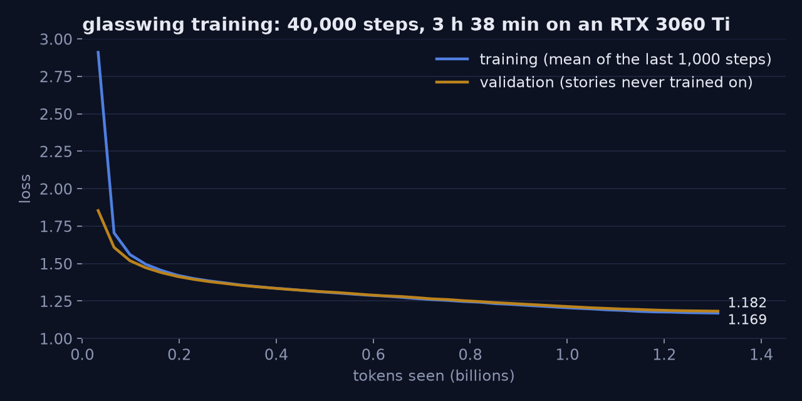

# M3 concepts: training, KV cache, sampling, speed

What M3 introduced, how each idea works, and where it lives in the code.

## 1. Training: next-token prediction and cross-entropy

`data.py` turns TinyStories into one long stream of token ids, each story preceded by
`<|endoftext|>`: 556M training tokens, stored as uint16 (2 bytes each, since 4096 < 65536). Training
picks random 257-token windows: the first 256 are the input, the same window shifted by one is the
target. One forward pass gives a prediction at all 256 positions at once (the causal mask makes that
honest), so every window is 256 training examples.

The **loss** at each position is `−ln(p)`, where p is the probability the model gave the token that
actually came next (**cross-entropy**). Averaged over all positions and the batch. Reference points:

| loss | meaning |
|---|---|
| 8.32 | ln(4096): uniform guessing, where training starts |
| 2.0 | the right token gets e⁻² ≈ 13.5% on average |
| 1.0 | ≈ 37% |

`e^loss` is the **perplexity**: "as unsure as choosing uniformly among this many tokens".

**Code:** `train.py`, `Batches.get` and `loss_fn`.

## 2. Optimizer and schedule

- **AdamW**: for each weight, a running mean of its gradient (momentum: keep going the way it's been
  going) and of the squared gradient (how noisy it is). The step is `mean / sqrt(squared mean)`, so
  every weight gets its own step size. Rare tokens with small gradients still learn.
  `betas=(0.9, 0.95)` are the averaging rates.
- **Weight decay 0.1** shrinks matrices slightly every step (regularisation). Not on norm weights:
  they're scales and should stay near 1.
- **Warmup** (1000 steps, LR from 0 to 1e-3): at the start the weights are random and the gradients
  point everywhere; full-size steps could push the model somewhere it never recovers from.
- **Cosine decay** (1e-3 down to 1e-4 by the last step): large steps explore, small steps settle into
  a minimum instead of bouncing across it.
- **Gradient clipping at 1.0**: if the gradient's overall length exceeds 1, scale it down. One odd
  batch can't throw the model off. `grad_norm` in the metrics shows how often it's needed.
- **Gradient accumulation**: 2 micro-batches of 64 × 256 tokens, gradients summed before one optimizer
  step: 32,768 tokens per step without needing the memory for all of them at once.

**Code:** `lr_at`, `make_optimizer`, the main loop in `train.py`.

## 3. bf16 mixed precision

| format | sign | exponent | mantissa | range | precision |
|---|---|---|---|---|---|
| f32 | 1 | 8 | 23 | ±3e38 | ~7 digits |
| fp16 | 1 | 5 | 10 | ±65504 | ~3 digits |
| **bf16** | 1 | 8 | 7 | ±3e38 | ~2 digits |

bf16 is f32 with the mantissa cut short: the same range, less precision. The tensor cores on the
3060 Ti multiply bf16 matrices much faster than f32. Under `torch.autocast`, the matrix
multiplications run in bf16; the stored weights, the optimizer state, softmax, the loss and our RMSNorm
stay in f32. fp16 would need loss scaling to keep small gradients from underflowing; bf16's exponent
range makes that unnecessary. The Rust engine is f32 throughout.

Measured: ~92k tokens/s on the 3060 Ti.

## 4. Reading the curves, checkpoints

Every 1000 steps: loss on 40 fixed validation batches (the same windows every time, so the numbers are
comparable), the average training loss since the last eval, a sample story, and a checkpoint.
- **Validation loss** is what matters: text the model never trained on. Training loss in the log is
  averaged over the last 1000 steps, so early on it lags behind (it includes the worse steps).
- **Overfitting** would show as validation loss rising while training loss keeps falling.
- **Checkpoints** hold the weights *and* the optimizer state (AdamW's running averages), so `--resume`
  continues exactly. They are written to a temp file and renamed, so a crash mid-write never leaves a
  broken checkpoint. Same idea as a database's write-ahead safety, at small scale.

### The run

| | |
|---|---|
| steps | 40,000 × 32,768 tokens = **1.31 billion tokens** (2.4 passes over the data) |
| time | **3 h 38 min** on the RTX 3060 Ti, ~92–101k tokens/s |
| final validation loss | **1.182** (perplexity e^1.182 ≈ 3.3), the lowest of the run |
| final training loss | 1.170 |

Validation loss kept falling to the last step and stayed right next to training loss: no overfitting,
even on the second and third pass over the data. The model would probably still improve with more
steps or width; 1.18 was a good place to stop for a model meant to be watched.

The early gap (training 2.91 vs validation 1.85 at step 1000) isn't overfitting in reverse: the
training number is the *average* over steps 1–1000, which includes the first, terrible steps.

Samples at temperature 0.8, top-p 0.9 (Rust engine, final weights):

> Once upon a time, there was a little girl named Sue. Sue had a red mitten that she loved very much.
> She wore it every day, even when it was cold outside. One day, Sue lost her mitten. She looked
> everywhere for it. She looked under her bed, in the toy box, and even in the kitchen. But she could
> not find her mitten. Sue was very sad. [...] They looked together and found the mitten under Sue's
> bed. Sue was so happy!

> Once upon a time, there was a little boy named Tim. He had a toy train that he loved to play with.
> [...] He learned that it is better to listen to his mom and stay safe.

Plot, problem, resolution and the moral TinyStories likes: at 15.7M parameters. Greedy stories from the
Rust engine and from PyTorch are identical on the final weights (`compare.py`, three prompts).

## 5. KV cache

To generate token n the model needs keys and values for tokens 1..n−1. They never change (the causal
mask means later tokens can't affect earlier ones), so `Session` stores them: per layer,
`[max_seq_len, K·Hd]` for keys and the same for values. Each step computes only the new token's
Q/K/V, appends K and V, and attends over the cache.

Memory: 2 × 8 layers × 256 positions × 384 × 4 bytes = **6.3 MB** per session. For big models with
long contexts this is gigabytes, which is why serving systems spend so much effort on it.

Measured (190 generated tokens, greedy):

| | tokens/s |
|---|---|
| no cache (`--no-cache`: re-run everything each step) | 1.0 |
| KV cache | 93.8 |

Without the cache, step n redoes n tokens, so total work grows with n².

`Model::forward` is now "a fresh `Session` given all tokens at once", so the M2 parity test also
covers the cache code. `kv_cache_gives_the_same_logits_as_a_full_pass` checks that one-at-a-time and
chunked runs give the same logits as one full pass.

**Code:** `crates/engine/src/model.rs` (`Session::run`, `block`, `attention`).

## 6. Sampling

`crates/engine/src/sample.rs`:
- **Greedy** (temperature 0): always the most likely token. Deterministic, gets repetitive.
- **Temperature**: divide logits by T before softmax. T < 1 sharpens (safer), T > 1 flattens (wilder).
- **Top-p** (nucleus): sort by probability, keep tokens until their mass reaches p (0.9), renormalise,
  sample. Cuts the long tail of unlikely tokens, whose combined mass otherwise produces nonsense now and
  then.
- **Seeded RNG** (xorshift64*): the same seed replays the same story, on every platform including wasm.

The CLI (`crates/cli`) prepends `<|endoftext|>` like training did, prefills the prompt in one call, then
decodes one token per step.

**End-to-end check:** `compare.py` generates greedily with PyTorch and with the Rust CLI on the trained
weights. All three prompts gave identical stories.

## 7. Speed: why generation is memory-bound

Each decode step reads every weight once (63 MB) and does one multiply-add with it. Compute per byte
read is tiny, so in theory the CPU waits on memory: **tokens/s ≈ memory bandwidth ÷ model size**.

In practice our first version wasn't even there:

| version | tokens/s | weight reads |
|---|---|---|
| plain `dot` (one running sum) | 94 | 5.9 GB/s |
| `dot` with 8 accumulators | ~295 | ~18.5 GB/s |
| same, compiled for AVX2 (`target-cpu=native`) | 275–360 (noisy) | ~17–23 GB/s |

Why the first jump: a single float sum must be added strictly in order (float addition isn't
associative, see M1), so the compiler may not split it across SIMD lanes. Eight independent sums give
it permission. Why the second step barely helps: once the arithmetic is vectorised, we're at the memory
wall (and training was using the same RAM at the time). From here only *smaller weights* help: f16 is
half the bytes per token (M4). The portable build stays, because WebAssembly can't use AVX anyway.

## Break-it lab: RoPE off by one, only in the decode path

The break: rotate a token by `start + 1` when exactly one token comes in.

Prediction: the fixture parity test still passes (it runs all tokens in one call); the KV-cache test
fails; generation doesn't crash but silently drifts from PyTorch.

Result:
- Parity: still green. KV-cache test: `position 10: max diff 6.30`. Not position 0: feeding every token
  one at a time shifts all positions by one *consistently*, and RoPE only sees distances, so a constant
  shift is invisible. It breaks where a 10-token prefill meets single-token steps, which is exactly how
  real generation works.
- `compare.py`: two stories identical, the third diverged at character 411 into equally fluent text.

Lesson: a test of the full-sequence path doesn't cover the incremental path, and plausible output is not
evidence of correctness. Fixed with `git revert`.
